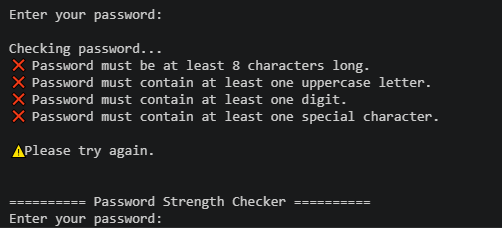
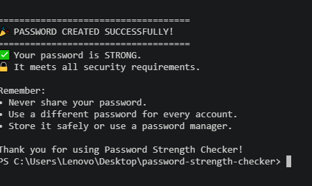

# 🔐 Password Strength Checker

## 📌 Project Overview

This is a beginner Python cybersecurity project that checks the strength of a user's password.

The program keeps asking the user to enter a password until it meets all the required security criteria.

---

## ✨ Features

- Checks if the password is at least 8 characters long
- Checks for at least one uppercase letter (A–Z)
- Checks for at least one lowercase letter (a–z)
- Checks for at least one digit (0–9)
- Checks for at least one special character
- Displays all validation errors at once
- Hides the password while the user types
- Continues asking for a new password until all requirements are met
- Displays a success message when a strong password is created

---

## 🛠️ Technologies Used

- Python 3

---

## ▶️ How to Run

1. Make sure Python 3 is installed.
2. Download or clone this repository.
3. Open the project folder.
4. Run the program:

```bash
python password_checker.py
```

---

## 📷 Example

```
Enter your password:
********

Checking password...

❌ Password must be at least 8 characters long.
❌ Password must contain at least one uppercase letter.
❌ Password must contain at least one digit.
❌ Password must contain at least one special character.

Please try again.
```

After entering a valid password:

```

====================================
🎉 PASSWORD CREATED SUCCESSFULLY!
====================================

✅ Your password is STRONG.
🔒 It meets all security requirements.

Remember:
• Never share your password.
• Use a different password for every account.
• Store it safely or use a password manager.
```

---

## 🎯 Learning Objectives

This project helped me practice:

- Variables
- Loops (`while`, `for`)
- Conditional statements (`if`, `elif`, `else`)
- String methods
- Boolean logic
- Password validation
- Basic cybersecurity concepts

---

## 🚀 Future Improvements

- Confirm password before saving
- Estimate password strength score
- Generate secure passwords
- Save password history (encrypted)
- Build a graphical user interface (GUI)

---

## 👨‍💻 Author

**Nardos Fekadu**

Artificial Intelligence | Python Learner